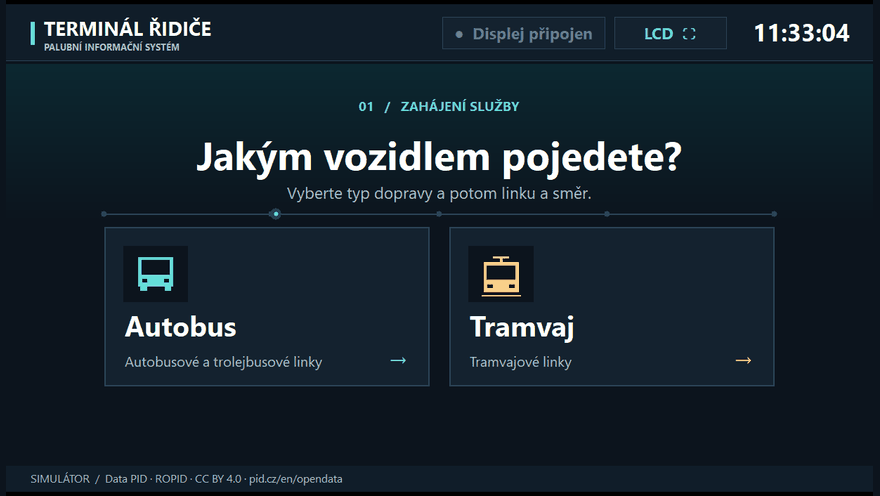
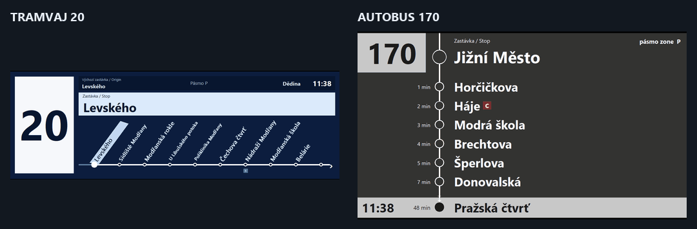
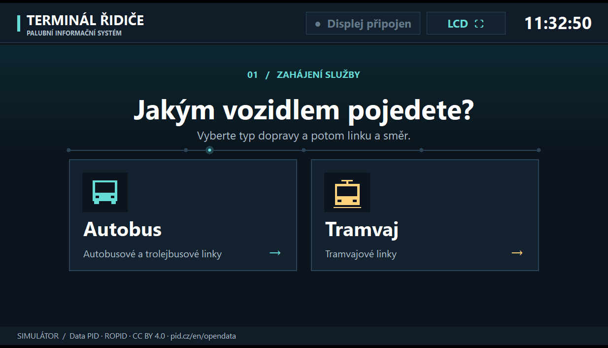
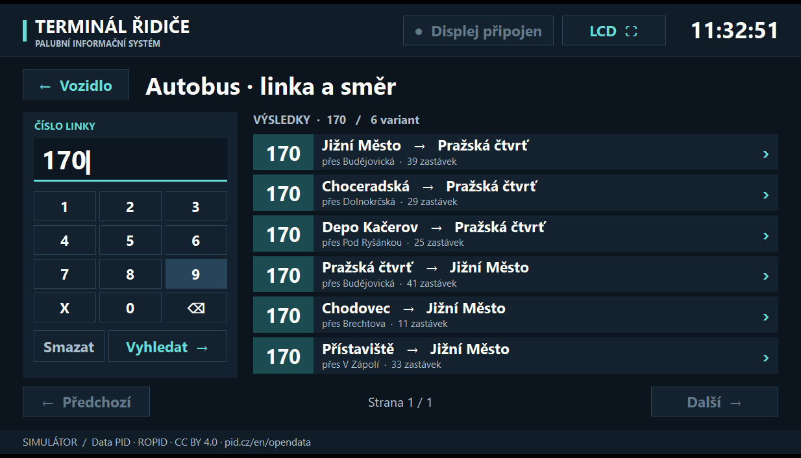
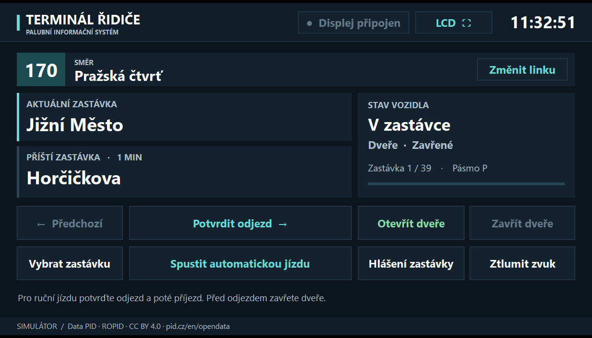
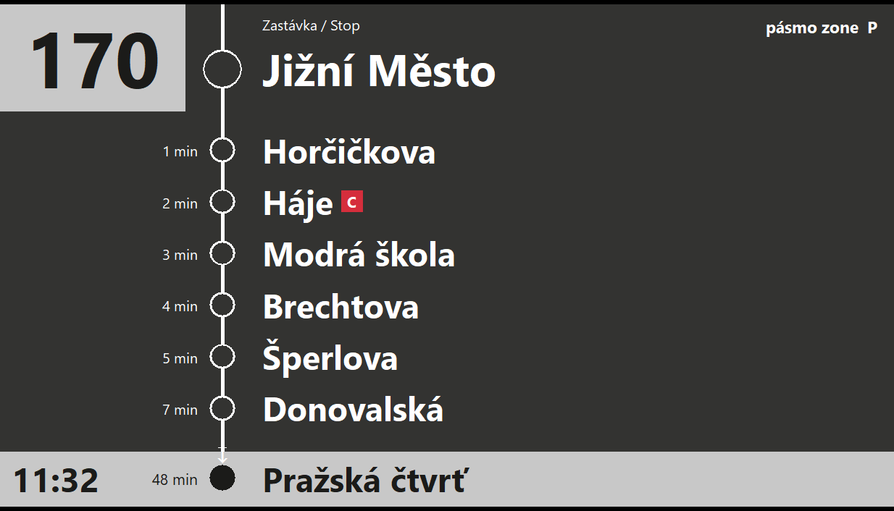
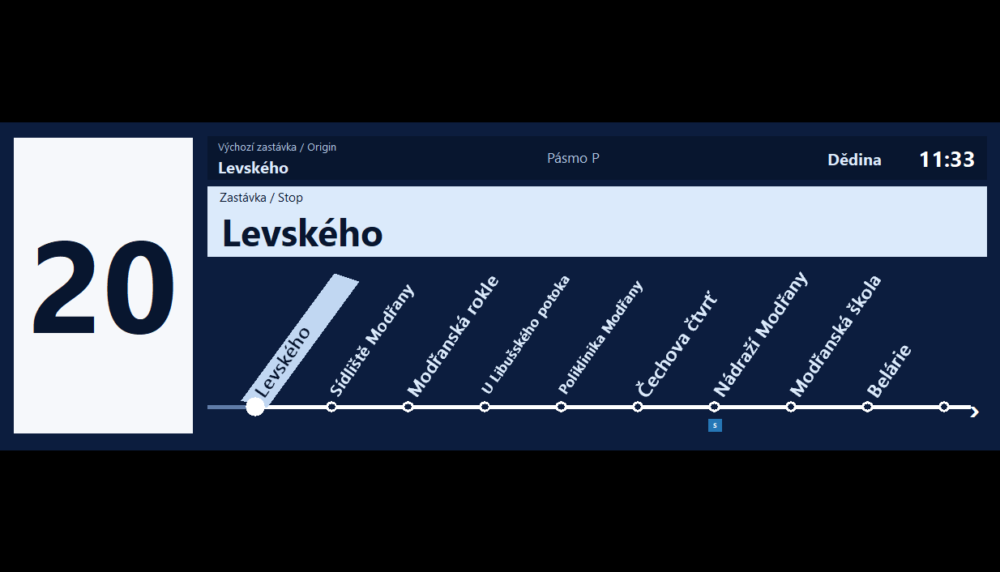
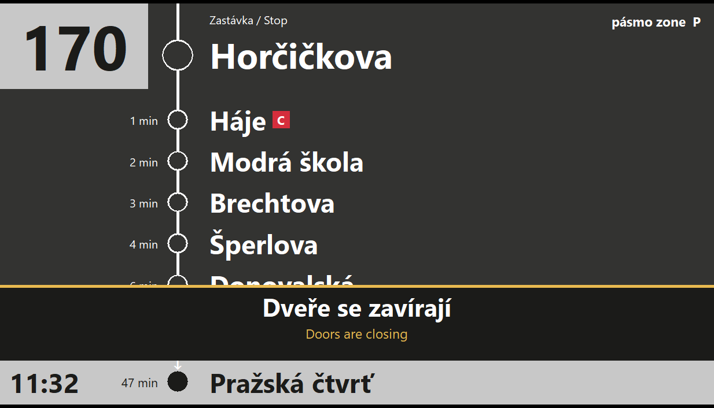

<div align="center">


# PID Display

**Terminál řidiče a palubní informační displej pražské MHD pro Windows**

[English](README.md) · [Čeština](README.cs.md) · [Русский](README.ru.md)

[Stáhnout pro Windows x64](https://github.com/stasspasjuk-rgb/PID-Display/releases/latest) · [Ukázky](#ukázky) · [Sestavení ze zdrojového kódu](#sestavení-ze-zdrojového-kódu)

**Rust · Windows x64 · 244 linek · České hlášení bez internetu**

</div>

## Jak zahájit jízdu

1. Stáhněte si `PID-Display-v4-Windows.zip` ze stránky nejnovějšího vydání a rozbalte jej.
2. Spusťte **`PID-Display.exe`**. Otevře se terminál řidiče a samostatné okno s displejem pro cestující.
3. Zvolte **Autobus** (i pro trolejbus) nebo **Tramvaj**. Zadejte číslo linky na klávesnici nebo pomocí tlačítek na obrazovce. Stiskněte **Enter** nebo **Vyhledat** pro přesnou shodu a vyberte směr.
4. Odjezd potvrďte tlačítkem **Potvrdit odjezd**, příjezd tlačítkem **Potvrdit příjezd**. Pro automatickou jízdu zvolte **Spustit automatickou jízdu**.

Při použití druhého monitoru na něj přesuňte okno displeje a na terminálu stiskněte **LCD ⛶**. Pokud okno displeje zavřete, můžete je znovu otevřít tlačítkem **Otevřít displej**.

## Ukázky

### Výběr vozidla a linky



### Přechod na další zastávku



## Snímky obrazovky

| Výběr vozidla | Vyhledání linky 170 |
| --- | --- |
|  |  |

| Terminál řidiče | Displej v autobusu |
| --- | --- |
|  |  |

| Displej v tramvaji | Upozornění na zavírání dveří |
| --- | --- |
|  |  |

## Funkce

| Funkce | Popis |
| --- | --- |
| Vyhledávání linek | 42 tramvajových, 195 autobusových a 7 trolejbusových linek včetně **5, 20, 120, 130 a 170**. Až tři varianty trasy v každém směru. |
| Terminál řidiče | Aktuální a příští zastávka, hodiny, cílová zastávka, tarifní pásmo, stav dveří a ruční výběr zastávky. |
| Displeje pro cestující | V autobusu se seznam zastávek posouvá nahoru. V tramvaji se vodorovné schéma s nakloněnými názvy zastávek posouvá doleva. |
| Dveře a hlášení | S otevřenými dveřmi nelze odjet. Při zavírání se zobrazí upozornění a zazní české hlášení. |
| Provoz bez internetu | Trasy a česká hlášení jsou součástí spustitelného souboru. |

## Sestavení ze zdrojového kódu

Nainstalujte [Rust pro Windows](https://rust-lang.org/tools/install/). Výchozí varianta MSVC vyžaduje Visual Studio Build Tools s podporou C++ a Windows SDK. Vydaná verze byla ověřena s nástroji GNU x64.

```powershell
git clone https://github.com/stasspasjuk-rgb/PID-Display.git
cd PID-Display
cargo test --locked --offline
cargo build --release --locked --offline
.\target\release\PID-Display.exe
```

Projekt nemá externí závislosti v Cargu. Python a hlasový model jsou potřeba pouze při generování nového zvuku. [Technická příručka v ruštině](docs/guide-ru.md) popisuje import GTFS a vlastní nahrávky.

## Data a zdroje

- **Trasy** vycházejí ze snímku městských dat GTFS PID ze **7. listopadu 2026**. Služební jízdy jsou vynechány a časy zastávek se počítají od začátku spoje. [Otevřená data PID](https://pid.cz/en/opendata/) · [CC BY 4.0](https://creativecommons.org/licenses/by/4.0/)
- **Displeje** vycházejí z autobusových panelů Čitelné Prahy a širokoúhlého LCD Bustec v tramvaji Škoda 15T. [Autobusové displeje PID](https://pid.cz/nova-grafika-citelne-prahy-v-autobusech-dpp-zobrazi-prestupy-i-orientacni-jizdni-dobu/) · [Fotografie LCD Bustec](https://www.busportal.cz/images/stories/2012/9645_aUltrawide_LCD_Praha_15T_tram.jpg)
- **Hlášení** využívá český hlas modelu Supertonic 3. [Karta modelu](https://huggingface.co/Supertone/supertonic-3) · [Licence modelu](https://huggingface.co/Supertone/supertonic-3/blob/main/LICENSE)

PID Display je neoficiální simulátor. Jízdy probíhají podle přiloženého snímku jízdních řádů.
