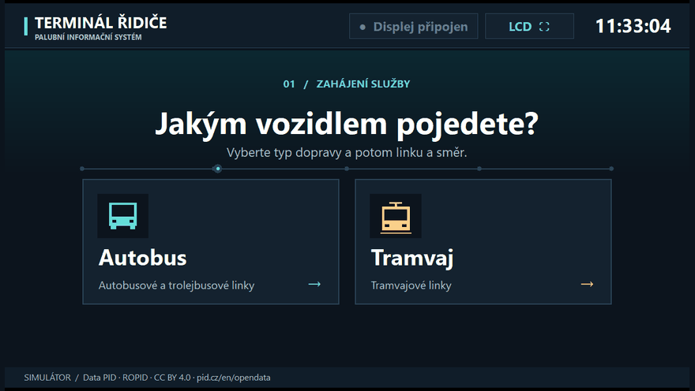
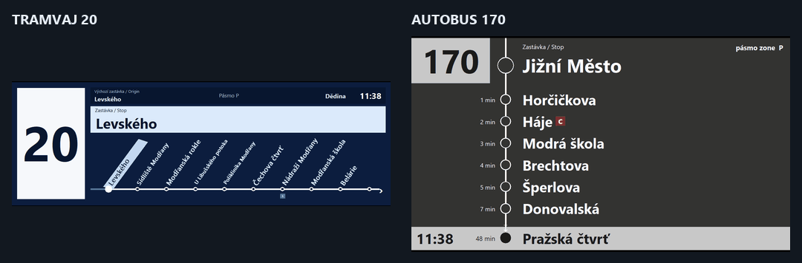
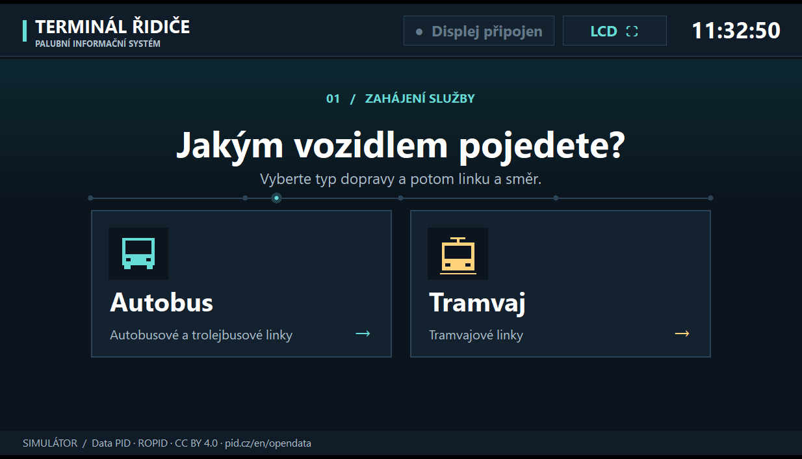
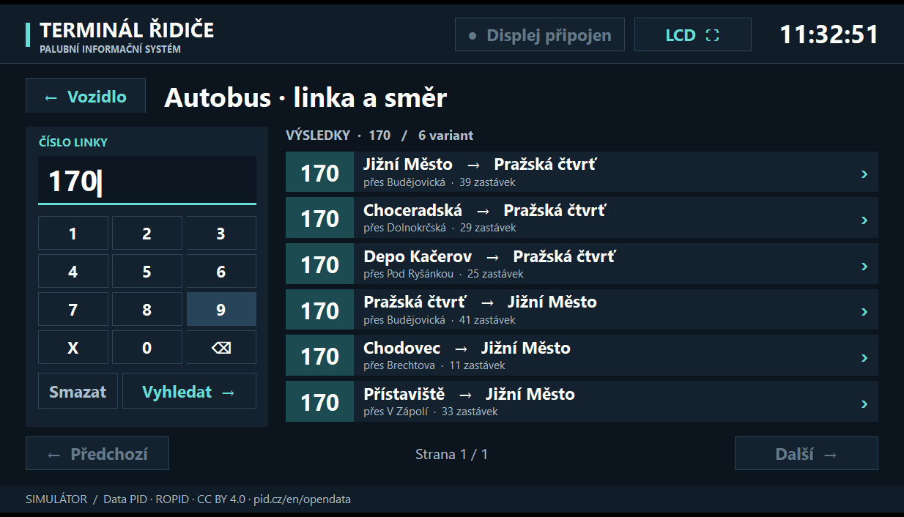
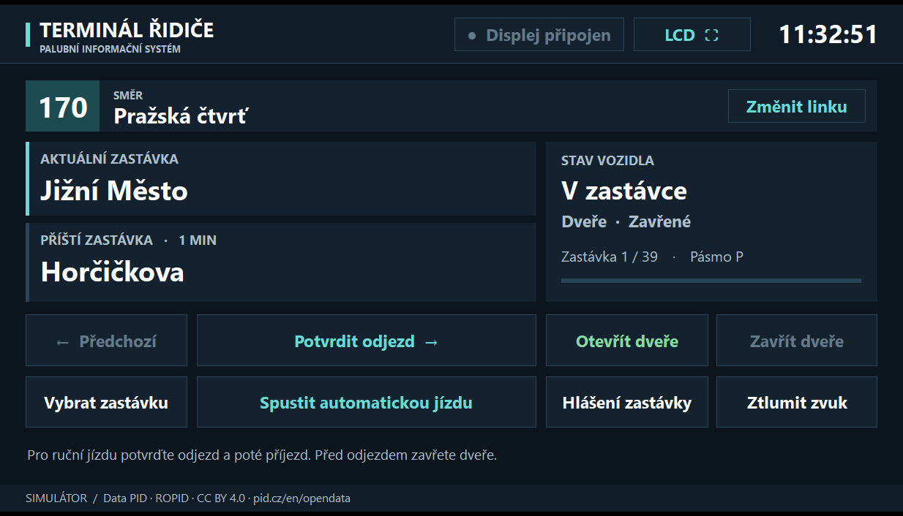
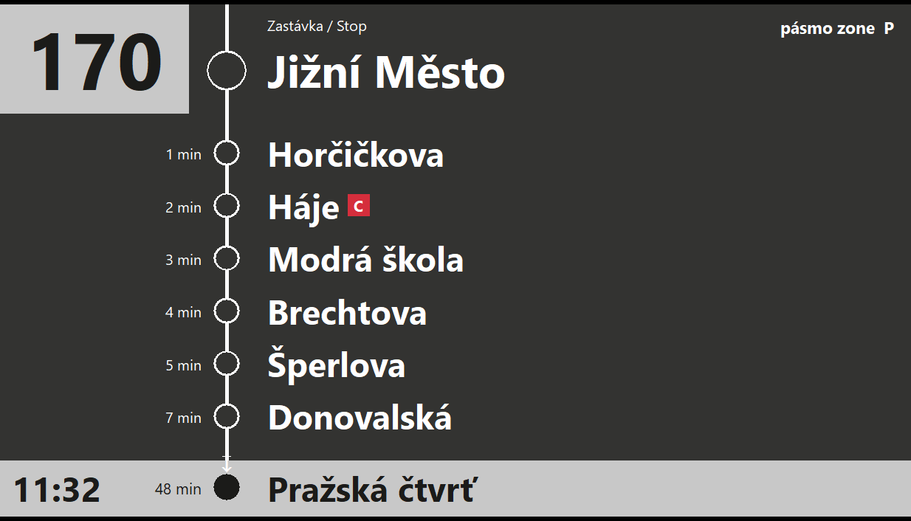
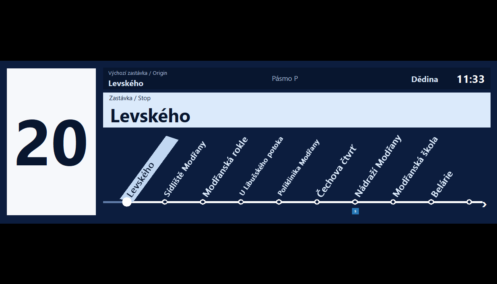
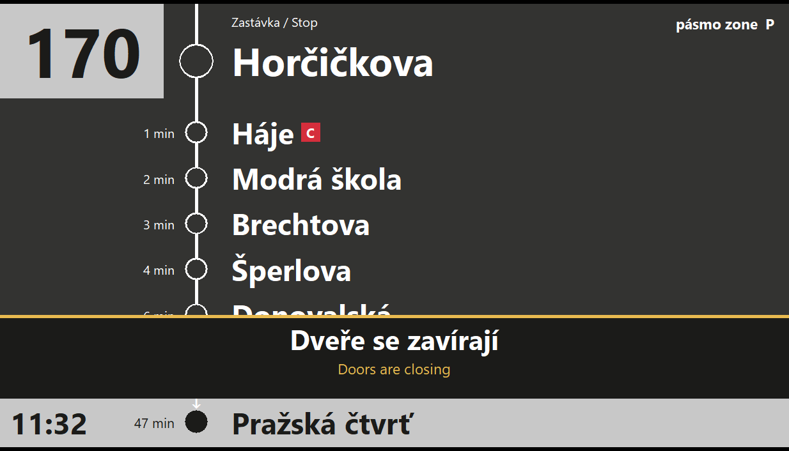

<div align="center">


# PID Display

**Prague public transport driver terminal and onboard passenger display for Windows**

[English](README.md) · [Čeština](README.cs.md) · [Русский](README.ru.md)

[Download for Windows x64](https://github.com/stasspasjuk-rgb/PID-Display/releases/latest) · [Demo](#demo) · [Build from source](#build-from-source)

**Rust · Windows x64 · 244 lines · Offline Czech announcements**

</div>

## Quick start

1. Download `PID-Display-v4-Windows.zip` from the latest release and extract it.
2. Run **`PID-Display.exe`**. It opens the driver terminal and a separate passenger display.
3. Select **Autobus** (bus or trolleybus) or **Tramvaj** (tram), then enter a line number using your keyboard or the on-screen keypad. Press **Enter** or **Vyhledat** for an exact match and select a direction.
4. Use **Potvrdit odjezd** to depart and **Potvrdit příjezd** to arrive, or select **Spustit automatickou jízdu** to run the trip automatically.

To use a second monitor, move the passenger window there, then press **LCD ⛶** on the driver terminal. If you close the passenger window, **Otevřít displej** reopens it.

## Demo

### Select a vehicle and route



### Next-stop transitions



## Screenshots

| Vehicle selection | Line 170 search |
| --- | --- |
|  |  |

| Driver terminal | Bus display |
| --- | --- |
|  |  |

| Tram display | Door closing warning |
| --- | --- |
|  |  |

## Features

| Feature | Details |
| --- | --- |
| Route search | 42 tram, 195 bus and 7 trolleybus lines, including **5, 20, 120, 130 and 170**, with up to three variants per direction. |
| Driver terminal | Current and next stop, clock, destination, fare zone, door state and manual stop selection. |
| Passenger displays | The bus display scrolls vertically. The tram display slides a wide horizontal route diagram with angled stop names. |
| Doors and audio | Open doors block departure. Closing the doors displays a warning and plays a Czech announcement. |
| Offline operation | Routes and Czech announcements are built into the executable. |

## Build from source

Install [Rust for Windows](https://rust-lang.org/tools/install/). The default MSVC toolchain requires Visual Studio Build Tools with C++ and the Windows SDK. The published executable was tested with the GNU x64 toolchain.

```powershell
git clone https://github.com/stasspasjuk-rgb/PID-Display.git
cd PID-Display
cargo test --locked --offline
cargo build --release --locked --offline
.\target\release\PID-Display.exe
```

Cargo has no external dependencies. Python and the speech model are needed only if you choose to regenerate the audio. The [technical guide](docs/guide-ru.md) covers GTFS imports and custom recordings.

## Data and credits

- **Routes** come from the PID urban GTFS snapshot dated **7 November 2026**. Non-passenger runs are excluded and stop times are expressed relative to departure. [PID Open Data](https://pid.cz/en/opendata/) · [CC BY 4.0](https://creativecommons.org/licenses/by/4.0/)
- **Display designs** are based on Čitelná Praha bus displays and the Bustec widescreen LCD in the Škoda 15T tram. [PID bus displays](https://pid.cz/nova-grafika-citelne-prahy-v-autobusech-dpp-zobrazi-prestupy-i-orientacni-jizdni-dobu/) · [Bustec LCD photograph](https://www.busportal.cz/images/stories/2012/9645_aUltrawide_LCD_Praha_15T_tram.jpg)
- **Announcements** use the Czech voice of Supertonic 3. [Model card](https://huggingface.co/Supertone/supertonic-3) · [Model license](https://huggingface.co/Supertone/supertonic-3/blob/main/LICENSE)

PID Display is an unofficial simulator. It runs simulated journeys using a bundled timetable snapshot.
