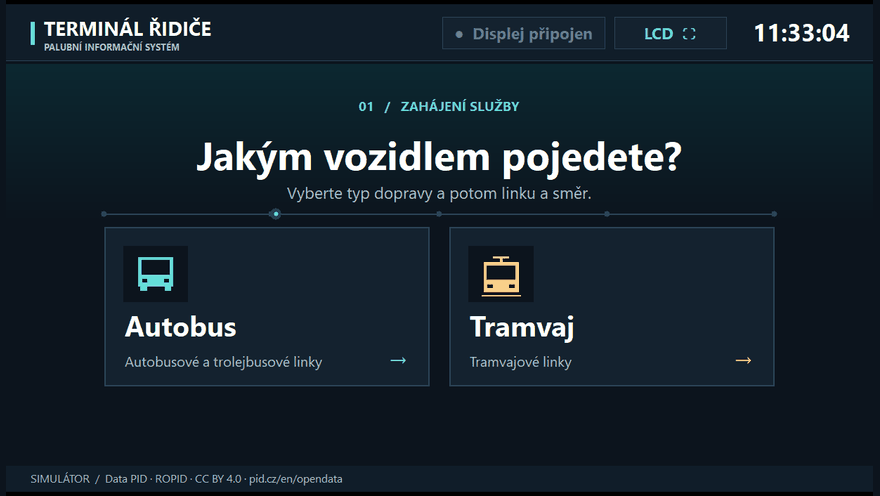
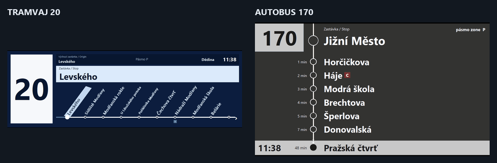
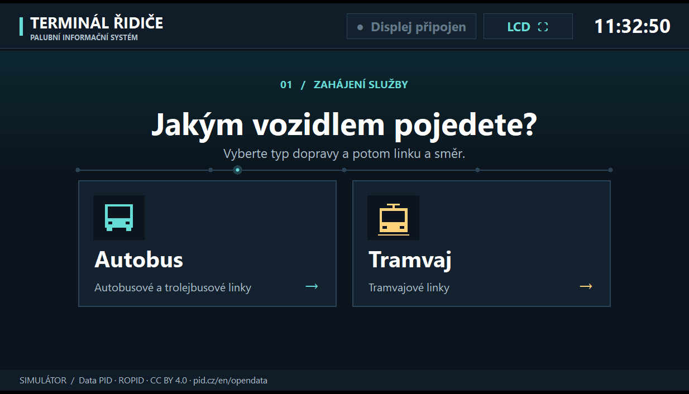
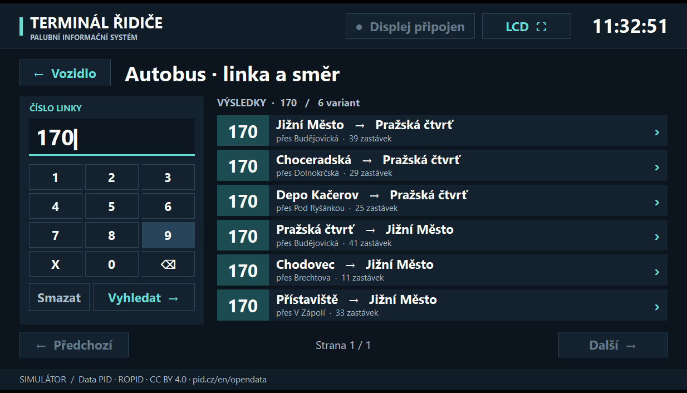
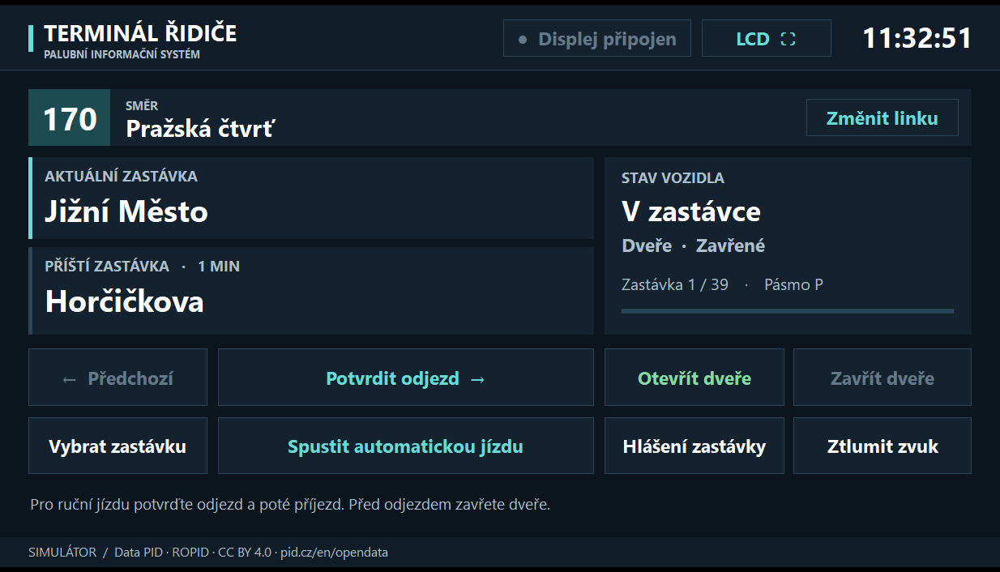
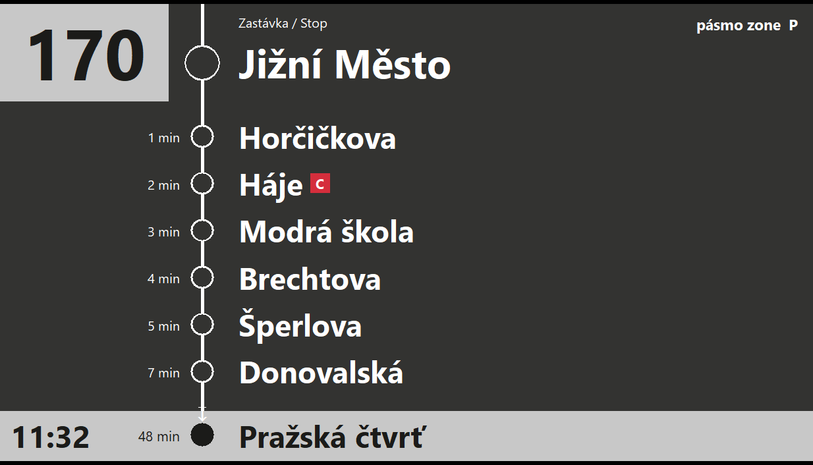
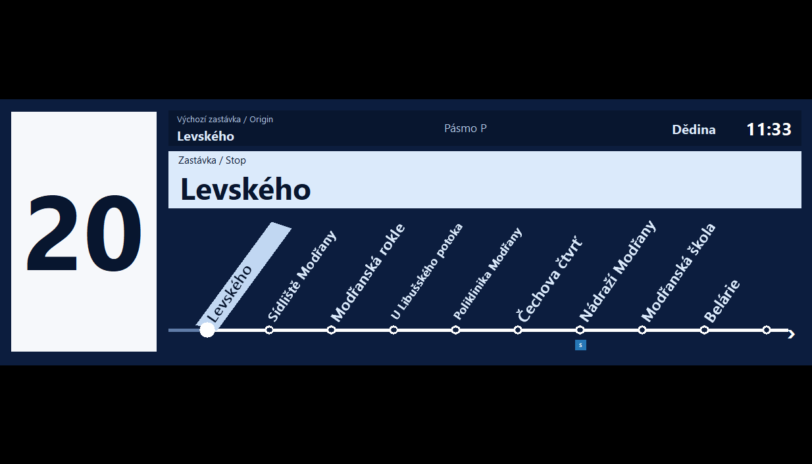
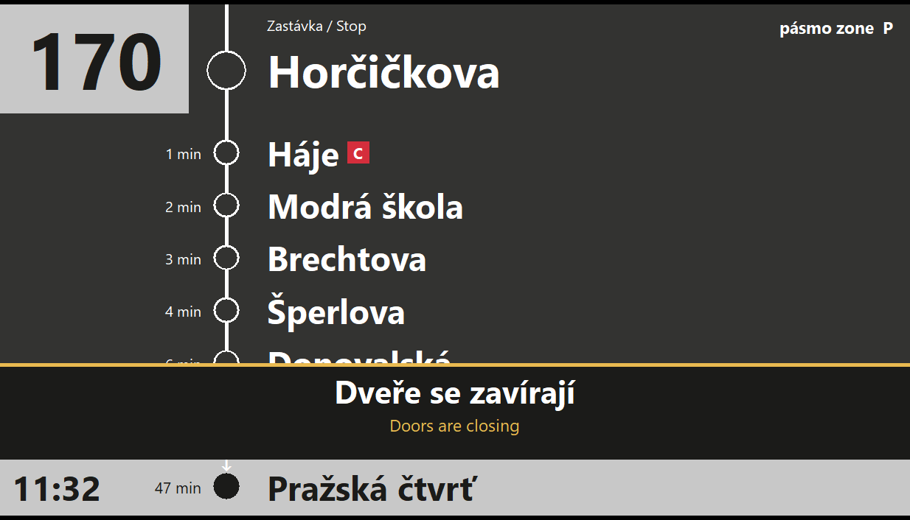

<div align="center">


# PID Display

**Пульт водителя и пассажирский LCD пражского транспорта в одном приложении Windows**

[English](README.md) · [Čeština](README.cs.md) · [Русский](README.ru.md)

[Скачать для Windows x64](https://github.com/stasspasjuk-rgb/PID-Display/releases/latest) · [Посмотреть демонстрацию](#демонстрация) · [Собрать из исходников](#сборка-из-исходников)

**Rust** · **Windows x64** · **244 линии** · **Офлайн-озвучка**

</div>

## Как начать поездку

1. Скачайте `PID-Display-v4-Windows.zip` со страницы релиза и распакуйте его.
2. Запустите **`PID-Display.exe`**. Откроются терминал водителя и отдельное окно для пассажиров.
3. Выберите **Autobus** или **Tramvaj**, введите номер на клавиатуре или экранной панели и выберите направление. Для точного поиска нажмите **Enter** или **Vyhledat**.
4. Нажмите **Potvrdit odjezd**, чтобы отправиться, и **Potvrdit příjezd**, чтобы прибыть. Для автоматической поездки выберите **Spustit automatickou jízdu**.

Для второго монитора перетащите туда пассажирское окно, затем нажмите **LCD ⛶** на пульте. Кнопка **Otevřít displej** возвращает пассажирское окно, если его закрыли.

## Демонстрация

### Выбор транспорта и линии



### Как меняется следующая остановка



## Скриншоты

| Выбор транспорта | Поиск линии 170 |
| --- | --- |
|  |  |

| Пульт водителя | Автобусный LCD |
| --- | --- |
|  |  |

| Трамвайный LCD | Закрытие дверей |
| --- | --- |
|  |  |

## Что умеет приложение

| Возможность | Как это работает |
| --- | --- |
| Поиск маршрутов | Встроены 42 трамвайные, 195 автобусных и 7 троллейбусных линий, в том числе **5, 20, 120, 130 и 170**. Доступно до трёх вариантов на направление. |
| Пульт водителя | Показывает текущую и следующую остановки, часы, направление, тарифную зону и состояние дверей. Поддерживает ручной выбор остановки. |
| Разные LCD | В автобусе список прокручивается вверх. В трамвае широкая горизонтальная схема с наклонными названиями сдвигается влево. |
| Двери и звук | При открытых дверях отправление заблокировано. При закрытии появляется предупреждение и звучит чешское объявление. |
| Офлайн-режим | Маршруты и чешские объявления встроены в EXE. Для обычного запуска не нужны Python, голосовой пакет или интернет. |

## Сборка из исходников

Установите [Rust для Windows](https://rust-lang.org/tools/install/). Для стандартного варианта Rust MSVC понадобятся инструменты сборки Visual Studio с C++ и Windows SDK. Готовый релиз проверен на GNU x64.

```powershell
git clone https://github.com/stasspasjuk-rgb/PID-Display.git
cd PID-Display
cargo test --locked --offline
cargo build --release --locked --offline
.\target\release\PID-Display.exe
```

В проекте нет внешних Cargo-зависимостей. Модель синтеза не нужна для сборки, поскольку в репозитории уже есть сгенерированное аудио. Исходники включают импортёр GTFS и инструмент пересборки звукового банка. Подробности и формат собственных записей описаны в [руководстве](docs/guide-ru.md).

## Данные и источники

- **Маршруты** взяты из городского снимка GTFS PID от **7 ноября 2026 года**. Служебные рейсы исключены, время остановок отсчитывается от начала поездки. Данные принадлежат Pražská integrovaná doprava / ROPID и распространяются по CC BY 4.0. [PID Open Data](https://pid.cz/en/opendata/) · [CC BY 4.0](https://creativecommons.org/licenses/by/4.0/)
- **Интерфейсы** воссозданы по опубликованным референсам. Для автобуса использованы панели Čitelná Praha, для трамвая — широкий LCD Bustec в Škoda 15T. [Автобусные экраны PID](https://pid.cz/nova-grafika-citelne-prahy-v-autobusech-dpp-zobrazi-prestupy-i-orientacni-jizdni-dobu/) · [Фото панели Bustec](https://www.busportal.cz/images/stories/2012/9645_aUltrawide_LCD_Praha_15T_tram.jpg)
- **Озвучка** сгенерирована на чешском с помощью Supertonic 3. Оригинальные записи DPP в комплект не входят. [Карточка модели](https://huggingface.co/Supertone/supertonic-3) · [Лицензия модели](https://huggingface.co/Supertone/supertonic-3/blob/main/LICENSE)

PID Display — неофициальный симулятор. Он использует встроенный снимок расписаний и имитирует движение по выбранному маршруту.
